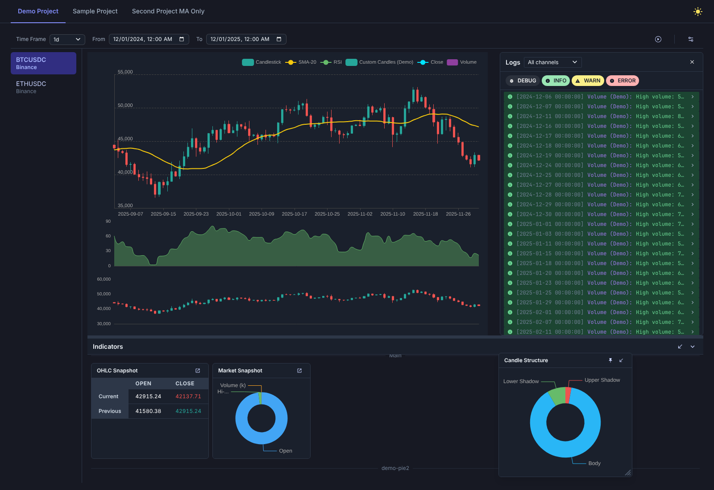

# Candle Engine

A self-hosted crypto charting and indicator workbench. Write your own indicators in Go, and Candle Engine runs them over historical OHLCV data from crypto exchanges and shows the results in a web UI as candlestick charts, sub-charts, tables and pie-chart widgets.



<sub>Screenshot of the built-in *Demo Project* running on generated sample data.</sub>

## Features

- **Exchange data sources:** Binance and Coinbase, with a file-backed cache so each candle range is downloaded only once.
- **Custom indicators in Go:** implement one small interface (`BaseIndicator`) and the engine calls it once per candle, oldest to newest.
- **Seven visualization types:** line, step line, bar, area, candlestick, table and pie chart.
- **Linked multi-panel charts:** overlays draw on the main chart, and each `TargetChart` gets its own panel. All panels share the time axis and crosshair.
- **Widgets:** table and pie-chart indicators appear as cards in the *Indicators* drawer. You can float them over the chart, drag and resize them, pin them, or send them back to the drawer.
- **Indicator logs:** indicators can log at Debug, Info, Warn and Error levels. The log panel can filter by level and by indicator.
- **Projects:** each project groups a set of trading pairs, indicators, a time frame, a date range and candle colors. You can switch pairs and projects from the UI.
- **Playback mode:** step or auto-play through history one candle at a time to see how indicators behaved bar by bar.
- **Light and dark themes**, plus a REST API documented with Swagger.

## Architecture

```
┌──────────────────────────┐      REST /api/v1       ┌──────────────────────────────┐
│  Frontend (React + Vite) │  ───────────────────▶   │  Backend (Go + Gin)          │
│  ECharts, Chakra UI,     │                         │  chart manager ─ projects    │
│  Zustand                 │  ◀───────────────────   │  indicator registry          │
└──────────────────────────┘   candles, indicator    │  cached sources ─▶ Binance / │
                               output, logs          │                    Coinbase  │
                                                     └──────────────────────────────┘
```

| Path | What's there |
|---|---|
| `backend/cmd/webserver` | Entry point. Registers sources, indicators and sample projects. |
| `backend/cmd/webserver/sample` | Example indicators (RSI, KAMA, MA, Volume) and a demo of every widget type. |
| `backend/pkg/indicators` | Indicator interface, config types and output handling. |
| `backend/pkg/sources` | Exchange clients (`binance`, `coinbase`) and multi-source data access. |
| `backend/pkg/cachedsource` | Caching wrapper that stores fetched candles in `backend/tmp/*.json`. |
| `backend/pkg/chartproject`, `chartmanager` | Projects and rendering (runs indicators over candles). |
| `backend/pkg/webserver` | Gin server, REST handlers, Swagger docs. |
| `frontend/` | React UI. See [`frontend/README.md`](frontend/README.md). |

## Getting started

### Prerequisites

- Go 1.25+
- Node.js 20+ and npm

### 1. Run the backend

```bash
cd backend
go run ./cmd/webserver
```

The API listens on `http://localhost:8080`, with Swagger UI at `http://localhost:8080/swagger/index.html`.

For live reload during development, use the bundled [Air](https://github.com/air-verse/air) tool, which also regenerates the Swagger docs:

```bash
cd backend
go tool air
```

Fetched candles are cached in `backend/tmp/`. Delete that folder to download fresh data.

### 2. Run the frontend

```bash
cd frontend
npm install
npm run dev
```

Open `http://localhost:5173`. To point the UI at a different backend, set `VITE_API_URL` (see `frontend/.env.example`).

## Writing an indicator

An indicator is a Go type that implements `BaseIndicator`:

```go
type SMA20 struct{}

func (s *SMA20) GetName() string                    { return "SMA-20" }
func (s *SMA20) GetType() indicators.IndicatorType  { return indicators.IndicatorTypeLine }
func (s *SMA20) GetConfig() indicators.IndicatorConfig {
	return indicators.IndicatorConfig{
		TargetChart:   "", // "" = overlay on the main chart
		LineIndicator: indicators.LineIndicatorConfig{LineThickness: 2, LineTitles: []string{"SMA-20"}},
	}
}

func (s *SMA20) HandleEntry(points indicators.PlotPointCollectionHistory, data sources.MultiSourceEntries,
	cfg indicators.ChartConfig, h indicators.IndicatorOutputHandler) (indicators.IndicatorOutputHandler, error) {
	if data.GetEntryCount(cfg.ActivePair) < 20 {
		h.SetSingleOutput(indicators.NewInvalidPlotPoint())
		return h, nil
	}
	var sum float64
	for i := 0; i < 20; i++ { // index 0 = current candle
		sum += data.GetEntry(cfg.ActivePair, i).Close
	}
	h.SetSingleOutput(indicators.PlotPoint{Value: sum / 20, Color: "#f6c90e"})
	return h, nil
}
```

Then register it and add it to a project in `backend/cmd/webserver/main.go`:

```go
reg.RegisterIndicators(&SMA20{})
// ...
project.AddIndicatorByName("SMA-20")
```

The full guide covers every indicator type, its config options, multi-pair access and logging: [`backend/docs/INDICATORS.md`](backend/docs/INDICATORS.md).

## Development

```bash
# Backend tests
cd backend && go test ./...

# Frontend lint and type check
cd frontend && npm run lint && npm run typecheck
```

## Roadmap

More data sources (Bitstamp, Bybit, Kraken) and structured logging are planned. See [`IDEAS.md`](IDEAS.md).
